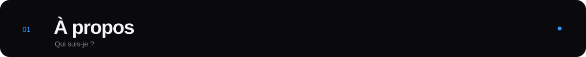
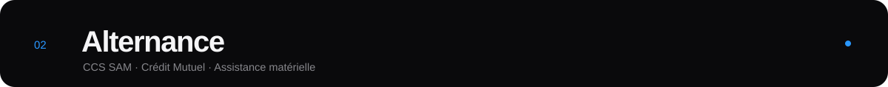
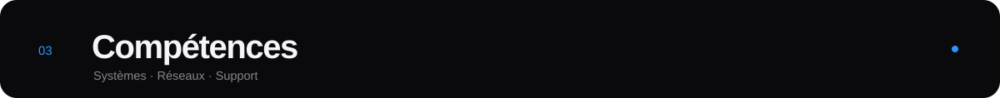
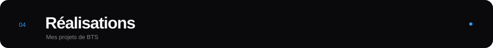
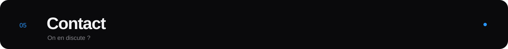

  <a href="https://angelovds.me"><picture><source media="(prefers-color-scheme: light)" srcset="assets/banner-apple-light.svg"></picture></a>

  
  
  

---

<picture><source media="(prefers-color-scheme: light)" srcset="assets/apple-1-light.svg"></picture>

Je m'appelle **Angelo Ventura De Sousa**, j'ai **19 ans**. Diplômé d'un **Bac Pro Systèmes Numériques** au lycée François Arago de Nantes, je suis aujourd'hui en **BTS SIO option SISR** à **MyDigitalSchool** (Saint-Herblain).

Je suis venu à l'informatique par les jeux vidéo et le matériel PC. En formation, j'aime le concret : installer des systèmes et des serveurs, mettre en place des services comme **GLPI**, déployer un parc en machines virtuelles et suivre l'actualité de la **cybersécurité**.

---

<picture><source media="(prefers-color-scheme: light)" srcset="assets/apple-2-light.svg"></picture>

En parallèle de mon BTS, je suis en **alternance au CCS SAM du Crédit Mutuel**, dans le service **assistance matérielle**. Avec l'équipe, on gère **à distance** le matériel informatique des collaborateurs. Les collaborateurs appellent notre ligne. De notre côté, on **décroche via la CTI Bar**, directement sur notre **poste de travail**. On traite ensuite leur demande depuis ce même PC. Quand le problème est résolu, on crée un **ticket** et on le clôture. Sinon, on le fait suivre au **niveau 2**. Et dès que c'est un problème matériel (casse, dysfonctionnement…), bref tout ce qui ne peut pas se régler à distance, on l'envoie aux **mainteneurs (EIS)**, qui interviennent sur place.

| Mission | Ce que je fais |
|---|---|
| **Prise d'appels** | Réponse aux appels des collaborateurs en décrochant via la CTI Bar sur mon poste de travail, puis prise en charge de leur problème |
| **Assistance à distance** | Prise en main à distance des postes pour diagnostiquer et résoudre les problèmes, sans se déplacer |
| **Postes de travail** | Diagnostic et dépannage des PC portables professionnels, des unités centrales, des écrans déportés et des dockings |
| **Périphériques** | Prise en charge des téléphones pro, souris, claviers, scanners de chèques, scanners de documents et du bip |
| **Réseau** | Diagnostic des dysfonctionnements réseau, notamment au niveau des câbles RJ45 |
| **Tickets** | Création d'un ticket pour chaque problème résolu, puis clôture une fois l'intervention terminée |
| **Escalade** | Transfert au niveau 2 si le problème n'est pas résolu, ou aux mainteneurs EIS pour tout problème matériel (casse, dysfonctionnement…) qui ne peut pas se régler à distance |

**Matériel géré**

---

<picture><source media="(prefers-color-scheme: light)" srcset="assets/apple-3-light.svg"></picture>

---

<picture><source media="(prefers-color-scheme: light)" srcset="assets/apple-4-light.svg"></picture>

| # | Réalisation | Domaine | Outils |
|:-:|---|---|---|
| 01 | **Maquette de parc en machines virtuelles** | Systèmes | VirtualBox, Windows 11, Windows Server 2025, Ubuntu, Linux Mint, Kali |
| 02 | **Projet RapidColis : modernisation du SI** | Gestion de projet | Cadrage, planification, schéma d'architecture |
| 03 | **Veille cybersécurité pour une PME** | Cybersécurité | Feedly, Google Alertes, CERT-FR, NVD, grille FACTO |
| 04 | **GLPI : installation et gestion des tickets** | Support · ITSM | GLPI, Debian, Apache, MariaDB, ITIL |
| 05 | **Audit SEO d'une page web** | Présence en ligne | Mots-clés, PageSpeed Insights, SERP |
| 06 | **Dossier d'inventaire de parc** | Patrimoine | GLPI Agent, OCS Inventory |

> Fiches techniques, guides utilisateurs et tableau de l'épreuve E5 : **[angelovds.me](https://angelovds.me)**

---

<picture><source media="(prefers-color-scheme: light)" srcset="assets/apple-5-light.svg"></picture>

  
  

